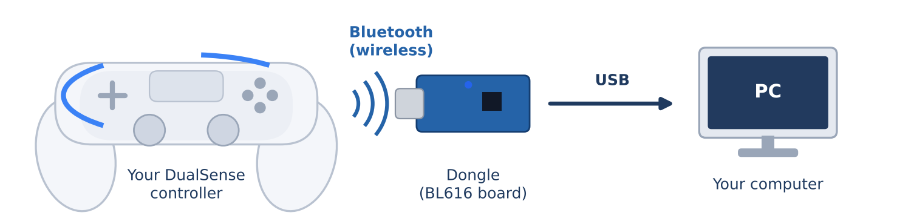
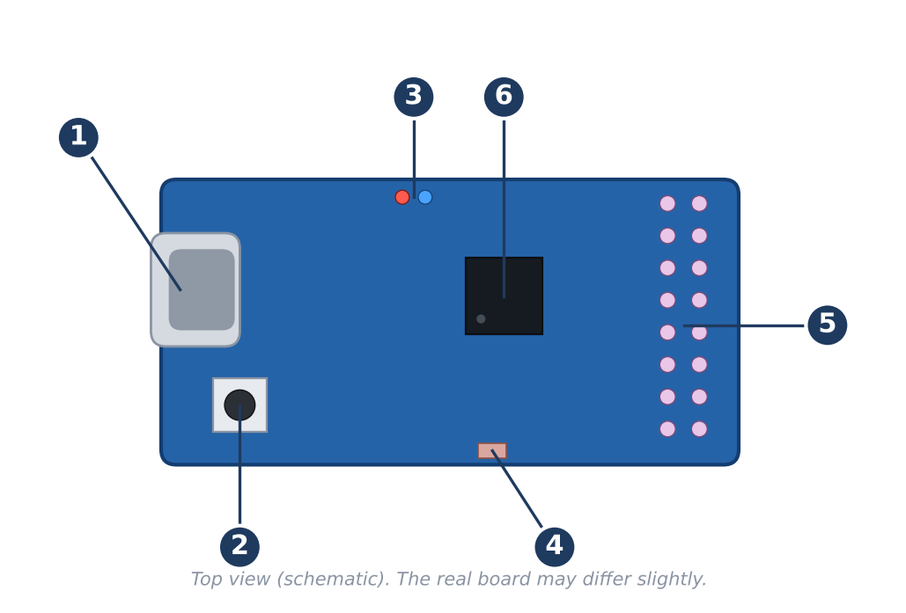
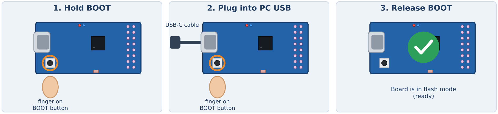
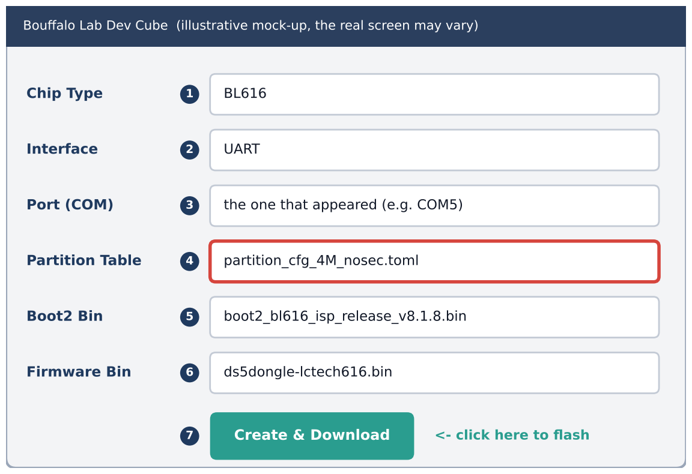
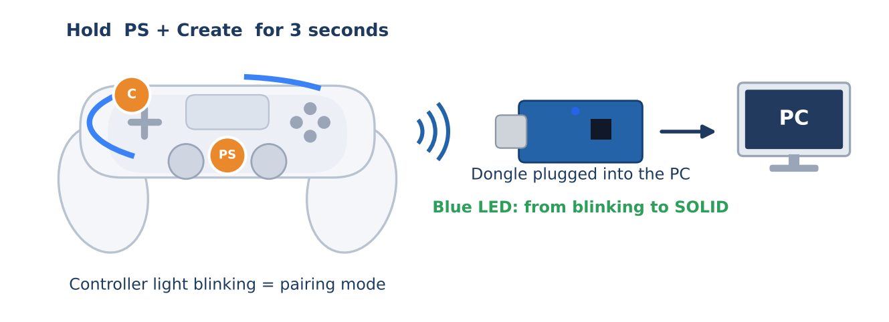
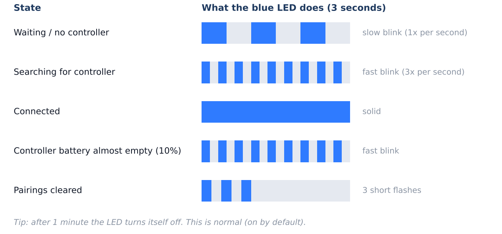
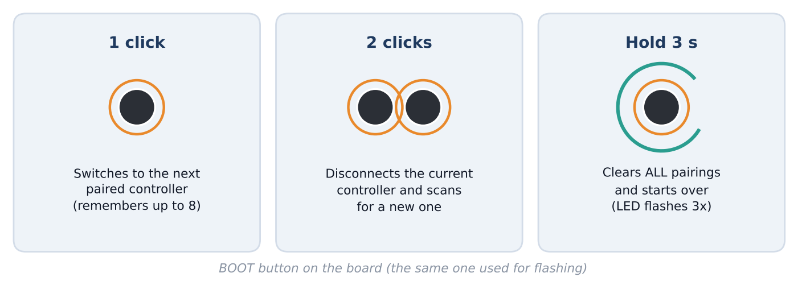
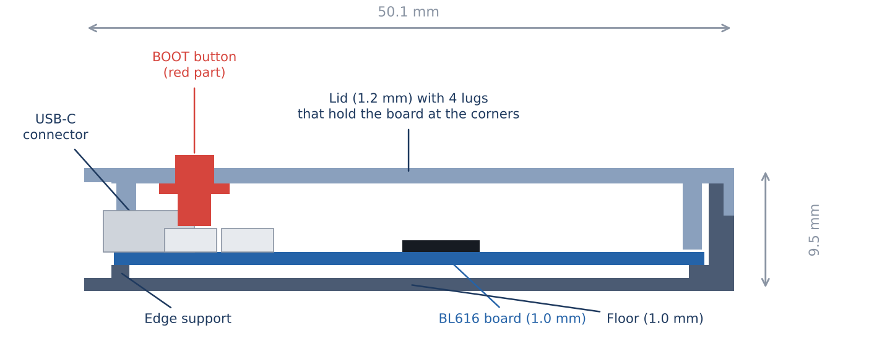

# DS5Dongle BL618

**English** | [Português](README_PT.md)

A wireless DualSense controller adapter based on BL616/BL618. It bridges a DualSense or DualSense Edge gamepad over Bluetooth Classic (BR/EDR) HID to a host PC via USB HID, appearing as a standard wired DualSense (VID 054C / PID 0CE6) or DualSense Edge (PID 0DF2). Fully compatible with Steam, SDL, PS Remote Play, and more.

Ported from [awalol/DS5Dongle](https://github.com/awalol/DS5Dongle) (Raspberry Pi Pico 2W). The BT stack was migrated from BTstack to Bouffalo SDK (Zephyr-based), and the USB stack from TinyUSB to CherryUSB.

> **Unofficial project** — not affiliated with or endorsed by Sony Interactive Entertainment. "DualSense", "DualSense Edge" and "PlayStation" are trademarks of Sony Interactive Entertainment. The USB VID/PID values (054C:0CE6 / 0DF2) are emulated so the host sees a standard wired controller; use at your own risk.

## Quick Start for Windows (prebuilt firmware, no programming)

A step-by-step guide for the **LCTech BL616** board. No soldering and no programming knowledge needed, about 10 minutes. (Portuguese version: [README_PT.md](README_PT.md) · PDF: [docs/guia-pt.pdf](docs/guia-pt.pdf).)



**You will need:** the BL616 board (blue, USB-C input and a button marked BOOT), a USB-C **data** cable (charge-only cables do not work), a Windows PC with internet, and a DualSense (PS5) or DualSense Edge controller.

### Know the board



| # | Part | What it is for |
|---|------|----------------|
| 1 | USB-C input | The cable to the PC plugs in here. Use a short data cable. |
| 2 | BOOT button | Used to flash the firmware and, later, to switch or clear controller pairings. |
| 3 | LEDs | Red = power. Blue = dongle status (see the LED table below). |
| 4 | Ceramic antenna | This is the Bluetooth antenna. Do not cover it with metal or foil. |
| 5 | Pin holes | **Not used.** The supplied 8-pin header can be kept aside. |
| 6 | BL616 chip | The brain: handles Bluetooth and USB. |

### Step 1 — Download the files

1. Download the firmware package (ZIP, about 1 MB): [ds5dongle-bl618-lctech616-v3.22.zip](https://github.com/sqlCRT/ds5dongle-bl618-opensource/releases/download/v3.22/ds5dongle-bl618-lctech616-v3.22.zip).
2. Right-click the ZIP → **Extract all...** (suggested folder: `C:\DS5Dongle`).
3. Download and install [Bouffalo Lab Dev Cube](https://dev.bouffalolab.com/download), the chip maker's official flashing tool.

*Prefer PowerShell?* From the root of this repository run the command below. It downloads the ZIP, extracts it to `C:\DS5Dongle`, verifies the SHA256 hashes and opens the folder:

```powershell
powershell -ExecutionPolicy Bypass -File docs\baixar-firmware.ps1
```

| File (inside the extracted folder) | What it is |
|------------------------------------|------------|
| `ds5dongle-lctech616.bin` | **FS** (Full-Speed) firmware — **start with this one**. Best cable/port compatibility. |
| `ds5dongle-lctech616-hs.bin` | **HS** (High-Speed) firmware — faster polling, needs a good cable and port. Optional. |
| `boot2_bl616_isp_release_v8.1.8.bin` | Board boot loader (required when flashing). |
| `partition_cfg_4M_nosec.toml` | Partition table: **always the `nosec` version**. |

### Step 2 — Put the board in flash mode



1. With the board **unplugged**, **press and hold** the BOOT button (use a paperclip or toothpick tip if needed).
2. Without releasing it, plug the USB-C cable into the PC.
3. Only now release the button.

**How do I know it worked?** Dev Cube (next step) will list a new **COM port** (e.g. COM5). If not: try another cable (charge-only cables do not work) or another USB port, or unplug and start over.

### Step 3 — Configure Dev Cube

Open Dev Cube, pick the chip and fill the fields as shown (the files are in the folder you extracted in Step 1):



> **Careful with field 4:** choose `partition_cfg_4M_nosec.toml`. A similar file without "nosec" in its name exists — **do not use it**.

### Step 4 — Flash the firmware

1. Check that all 6 fields are filled and click **Create & Download**.
2. Wait for the progress bar to finish and the success message. **Do not unplug the cable while flashing.**
3. Unplug and plug the cable again, **without pressing BOOT**.
4. The blue LED should **blink slowly**: the dongle is ready and waiting for a controller.

### Step 5 — Pair the controller



1. With the dongle plugged in (LED blinking slowly) and the controller **off**, hold **PS + Create** for 3 seconds until the controller light starts blinking.
2. Within a few seconds the dongle LED blinks fast (searching), then turns **solid**: connected.
3. Windows now sees a **"DualSense Wireless Controller"**, as if it were wired. Open a game or Steam and test.

> **Tips:** do not pair the controller through Windows Bluetooth (the dongle does it by itself). If the controller was connected to another device (PS5, phone), turn that device's Bluetooth off first. Next time just turn the controller on with the PS button: it reconnects on its own.

#### What the blue LED is telling you



### Daily use



- **Create + Options for 3 seconds:** toggles between DualSense mode and **Xbox 360** mode (XInput-compatible games). The controller rumbles and the dongle restarts by itself.
- **PS button:** can wake the PC from sleep (on by default). After waking, press PS again to reconnect.
- **Configuration page (optional):** with the dongle plugged in, open [ps5.ds5678.top](https://ps5.ds5678.top) in **Chrome or Edge** and allow device access. You can change polling rate, haptics strength, remap buttons, light-bar color, Xbox mode, idle power saving and more. Online OTA does not work with this open-source build: to update, flash again with Dev Cube.

### If something does not work

| Symptom | What to do |
|---------|------------|
| Dev Cube shows no COM port | Charge-only cable or bad port. Swap the cable/port and redo Step 2 (BOOT held **before** plugging in). |
| Flashed, but the blue LED does not light | Unplug and plug again. If it persists, flash again making sure you used the **nosec** partition. |
| Controller does not connect | Controller off? Hold PS + Create until it blinks. If it connected before, hold the dongle's BOOT for 3 s (clears pairings) and pair again. |
| Does not reconnect after being idle | In the configuration page, turn off idle auto-disconnect. |
| Audio cutting out, stutter, disconnects | Use a rear USB port (straight on the motherboard) and a good, short cable. Prefer the FS firmware over HS. |
| The LED turned itself off | Normal: it turns off after 1 minute. The controller still works. |

> **Important:** after flashing v3.18 or newer you **cannot go back** to a version older than 3.18 (the board stops booting; it can only be recovered by flashing a newer version over the serial port).

### 3D-printed case (optional)

A two-piece snap-fit case (no screws) for the BL616 board: external size **50.1 × 27.1 × 9.5 mm**, no pin header, with a USB-C opening for common plugs, a window for the LEDs and a plunger for the BOOT button.



- Files: [`case-3d/saida/`](case-3d/saida) — `ds5dongle_case_base.step`, `ds5dongle_case_tampa.step` (lid), `ds5dongle_case_botao.step` (button); `_montada.step` is for viewing only.
- Regenerate or tweak the dimensions with `case-3d/case.py` (CadQuery) or just run `py case-3d\gerar_tudo.py`.
- **Dimensions were estimated from the listing photos** (board ≈ 45.5 × 22.5 mm). Measure your board with calipers and **print only the base first** to test the fit.
- PLA or PETG, 0.4 mm nozzle, 0.2 mm layers, no supports. Base: floor down. Lid: upside down. Button: thin tip (top) down.
- Assembly: board in the base (USB-C on the wide-opening side) → red button under the lid with its tip through the hole → press the lid on. Use the notch at the end opposite the USB to pry it open.

---

## Supported Boards

| Board | Chip | USB | LED | Debug |
|-------|------|-----|-----|-------|
| **LCTech BL616** (default) | BL616 QFN32 | Type-C native | 1x blue (GPIO27) | External USB-TTL |
| **Ai-M61-32S-Kit** | BL618 QFN56 | GPIO37/38 fly-wire | RGB + white (4 LED) | Type-C CH340 |
| **Sipeed M0S Dock** | BL616 QFN32 | Type-C native | 2x red (GPIO27/28) | External USB-TTL |

> **The default build target is LCTech BL616.** `build_macos.sh` (and the `build_lctech616.sh` wrapper) builds for it out of the box; use `BOARD_TYPE=aim61` or `BOARD_TYPE=m0sdock` for the other boards.

LED pin assignments and USB topology differ per board and are handled at compile time via `board_config.h`.

## Hardware Requirements

- **LCTech BL616**, **Ai-M61-32S-Kit**, or **Sipeed M0S Dock** dev board
- **DualSense controller** (standard 0CE6) or **DualSense Edge** (0DF2, auto-detected)
- LCTech BL616 / M0S Dock: just a USB-C cable (native USB)
- For Ai-M61-32S-Kit: **USB data cable** (cut and wire to USB_DM/USB_DP header pins)
- For LCTech / M0S Dock serial debug: **USB-TTL adapter** (CH340/CH341, 3.3V)

### USB Wiring (Ai-M61-32S-Kit only)

The on-board Type-C port is a UART bridge (for flashing/debug). Native USB must be wired from header pins:

```
Pin 37 (USB_DM) → USB D- (white)
Pin 38 (USB_DP) → USB D+ (green)
GND              → USB GND (black)
```

If the host does not supply power over USB, the board needs separate power via its Type-C port.

> **LCTech BL616 / M0S Dock**: USB is natively connected via Type-C. No wiring needed.

## Building from Source (developers)

### 1. Bouffalo SDK (DS5Dongle fork — required)

> The official Bouffalo SDK will **not** work with this project — it is missing the required BT HID net_buf pools and USB Audio request handling. You must use the project's SDK fork:

```bash
git clone https://github.com/sqlCRT/bouffalo_sdk.git bouffalo_sdk
```

The build script expects the SDK in `../bouffalo_sdk` (a sibling directory of this repository) and builds against the fork's `master` branch. The fork is based on upstream v2.3.28 with targeted DS5Dongle BL618 modifications; see its README for details.

### 2. Dependencies

```bash
# macOS
brew install cmake
brew install make          # GNU Make 4.0+ required by SDK

# Linux (Ubuntu)
sudo apt install cmake make
```

### 3. RISC-V Toolchain

BL616/BL618 uses the T-Head extended ISA. A standard `riscv64-elf-gcc` will not work.

```bash
# macOS ARM64 — community pre-built T-Head toolchain
curl -L https://github.com/beckmx/bouffalo_labs_mac_toolchain/releases/download/v1.0/riscv64-unknown-elf-toolchain.tar.gz \
  | tar xz -C ~/riscv-toolchain

# Linux — the SDK ships its own toolchain, or download from T-Head
```

`build_macos.sh` auto-detects the toolchain under `~/riscv-toolchain/toolchain/bin`.

### 4. Build

```bash
cd ds5dongle-bl618

# LCTech BL616 — default
bash build_macos.sh build      # incremental compile (-j auto)
bash build_macos.sh rebuild    # clean + compile
# or: bash build_lctech616.sh rebuild

# Ai-M61-32S-Kit
BOARD_TYPE=aim61 bash build_macos.sh rebuild

# Sipeed M0S Dock
BOARD_TYPE=m0sdock bash build_macos.sh rebuild
# or: bash build_m0sdock.sh rebuild

# USB speed — Full-Speed is the default (best cable compatibility);
# use USB_SPEED=hs for the High-Speed 480 Mbps variant
USB_SPEED=hs bash build_macos.sh rebuild

# Other commands
bash build_macos.sh clean      # clean only
bash build_macos.sh strip      # remove .o/.a to shrink build dir
```

- **Default board: LCTech BL616** (`BOARD_TYPE=lctech616`).
- **Default USB speed: Full-Speed (12 Mbps)**; pass `USB_SPEED=hs` to build the High-Speed variant (higher polling ceiling, more sensitive to cable quality).
- Switching `BOARD_TYPE` or `USB_SPEED` triggers an automatic clean rebuild (CMake cache incompatible).

Output: `firmware/{board}/ds5dongle-{board}.bin` (~800 KB) plus boot2/partition files and a `flash_prog_cfg.ini`. Built binaries are git-ignored — attach them to a GitHub Release if you want to distribute prebuilt firmware.

#### Windows

On Windows, clone the T-Head toolchain and use the provided script:

```bat
git clone https://gitee.com/bouffalolab/toolchain_gcc_t-head_windows.git

build_windows.bat both         rem build Full-Speed + High-Speed variants
build_windows.bat rebuild      rem LCTech BL616, Full-Speed
build_windows.bat              rem incremental build
build_windows.bat flash COM5   rem flash via serial
```

`build_windows.bat both` produces both `ds5dongle-lctech616.bin` (Full-Speed) and `ds5dongle-lctech616-hs.bin` (High-Speed); a single High-Speed build is also possible via `USB_SPEED=hs build_windows.bat rebuild`.

The script expects the DS5Dongle BL618 SDK fork at `..\bouffalo_sdk` (step 1) and the toolchain at `%USERPROFILE%\Desktop\toolchain_gcc_t-head_windows` by default. Override with the `BL_SDK_BASE` / `TOOLCHAIN_PATH` environment variables; other boards via `BOARD_TYPE=aim61` / `BOARD_TYPE=m0sdock`.

### 5. Flash

#### LCTech BL616 — Dev Cube (UART/ISP mode)

1. Build the firmware first — the build script outputs `ds5dongle-lctech616.bin`, `boot2_bl616_isp_release_v8.1.8.bin` and `partition_cfg_4M_nosec.toml` into `firmware/lctech616/`.
2. Hold the **BOOT** button on the LCTech BL616, then plug the board into the PC via USB-C, keeping BOOT held until the board enters UART (ISP) download mode.
3. Open [Bouffalo Lab Dev Cube](https://dev.bouffalolab.com/download), select chip **BL616**, and use the **ISP (UART)** flashing mode.
4. Select the board's COM port, then load these files:
   - Partition table: `firmware/lctech616/partition_cfg_4M_nosec.toml`
   - Boot2: `firmware/lctech616/boot2_bl616_isp_release_v8.1.8.bin`
   - Firmware: `firmware/lctech616/ds5dongle-lctech616.bin`
5. Start the download.

> Use the `_nosec` partition table (`partition_cfg_4M_nosec.toml`), not `partition_cfg_4M.toml`.

Alternatively, flash via the build script:

```bash
bash build_macos.sh flash /dev/tty.usbserial-xxx
```

Other boards follow the same Dev Cube flow; use the files generated under `firmware/{board}/`.

## Usage

1. Connect the LCTech BL616 board's Type-C port to the target host (power + USB data). For serial debug, additionally connect a USB-TTL adapter (CH340/CH341, 3.3V)
2. Put the controller in pairing mode (hold **PS + Create** for 3 seconds, light bar flashes)
3. Watch the on-board blue LED for status (see LED table below)
4. The host should see "DualSense Wireless Controller"

> **Ai-M61-32S-Kit note:** its Type-C port is a UART bridge (flashing/debug only) — native USB must be wired from header pins (USB_DM/USB_DP/GND) to the target host, see USB Wiring above.

### LED Status Indicators

LCTech BL616 has a single blue LED (GPIO27); states are distinguished by blink cadence:

| State | Pattern (single blue LED) |
|-------|---------------------------|
| Idle / waiting to pair | Slow blink (~1Hz) |
| Scanning | Fast blink (~3Hz) |
| Connected | Solid |
| Just disconnected | Blink (~1Hz) for ~3s, then back to idle slow blink |
| Battery ≤20% (discharging) | Medium blink (~1.7Hz) |
| Battery ≤10% (discharging) | Fast blink (~3Hz) |
| Auto-off | Off after 1 min (on by default; battery warnings unaffected) |
| Event acknowledge | Single flash |
| Bonds cleared | Triple flash |

> **Ai-M61-32S-Kit note (RGB + white LEDs):** idle = purple slow blink (1Hz); scanning = purple fast blink (~3Hz); connected = green solid; just disconnected = red slow blink, auto-transition to purple after ~3s; battery ≤20% = green-yellow medium blink; battery ≤10% = red medium blink; event acknowledge = blue single flash; bonds cleared = blue triple flash.
>
> **Sipeed M0S Dock note (two red LEDs, GPIO27/28):** LED0 (near Type-C) blinks for idle/scanning, LED1 stays solid when connected; disconnect = both sync blink; battery warning = LED0 fast blink; critical = both blink.

### BOOT Button Gestures

| Gesture | Action |
|---------|--------|
| **Single click** | Switch to the next paired controller (up to 8 remembered) |
| **Double click** | Disconnect current controller + scan for a new one (link keys preserved) |
| **Long press (3s)** | Clear all bonds + start scanning (triple LED flash to confirm) |

## Features

### Implemented

- BT Classic HID Host: inquiry, SDP, L2CAP, SSP auto-pairing
- Full input passthrough: sticks, buttons, triggers, gyro, accelerometer, touchpad, battery
- Full output passthrough: rumble, RGB light bar, player indicators, adaptive triggers
- Audio passthrough (bidirectional): UAC1 4ch 48kHz OUT → Opus encode → BT 0x39 dual-frame report (547B, speaker/headset); BT mic Opus → decode → UAC1 2ch 48kHz IN (microphone)
- HD haptics: USB Audio Ch2/Ch3 → 16:1 decimation → BT 0x92 haptic tag
- DualSense Edge full support: auto-detect → unlock handshake → profile prefetch → 437B descriptor, PID auto-switch (0DF2)
- Multi-controller memory: remembers up to 8 paired controllers, single click to switch
- Controller-initiated reconnect via L2CAP server registration (passive model)
- Robust reconnection: periodic scan retry (~30s), connection watchdog (3s no-input detection), Link Supervision Timeout (5s), system reset fallback for stale ACL cleanup
- Idle timeout: configurable 0–60 min auto-disconnect (default 30 min)
- PS shortcut: short press → Win+G, long press → Win+Tab
- Configurable polling rate: 250Hz / 500Hz / real-time (~750Hz, follows the BT report rate)
- Button remap: remap any controller button to another controller button (Feature Report 0xFB)
- MuteLight: mic button LED control (toggle on/off via the controller mute button)
- USB remote wakeup: 6-state FSM + Boot Keyboard + auto power-off after 5s suspend
- USB stealth mode: hide the USB device until a controller connects (configurable)
- Custom controller light-bar color (default white), plus on-board RGB status LED
- USB serial number: unique chip ID from eFuse (configurable, on by default)
- Trigger motor power reduction: configurable 0–10 levels
- Volume lock: prevent the host from changing controller speaker/headset volume
- LED auto-off: steady LEDs turn off after 1 min (on by default; battery warnings unaffected)
- Battery alerts: ≤20% green-yellow blink warning, ≤10% red blink critical
- Multi-board support: LCTech BL616 (default), Ai-M61-32S-Kit, Sipeed M0S Dock — compile-time board selection
- Build-time log level control (`LOG_LEVEL` 0–3)
- FreeRTOS multi-task architecture (BT / USB / Audio / Mic)

### Known Limitations

| Item | Description |
|------|-------------|
| Single active controller | One controller connected at a time; up to 8 pairings remembered (single click switches) |

### Controller Feature Compatibility

The USB side presents DualSense-compatible HID descriptors (auto-switching between DS and Edge; standard wired layout plus dongle-config Feature Reports 0xF6–0xF9 / 0xFB), so hosts treat the dongle like a wired controller.

| Feature | Data Path | Supported |
|---------|-----------|-----------|
| Sticks / Buttons / Triggers | HID Input passthrough | Yes |
| Gyro / Accelerometer | HID Input passthrough | Yes |
| Touchpad | HID Input passthrough | Yes |
| Battery level | HID Input passthrough | Yes (+ on-board LED low-battery alert) |
| **Adaptive triggers** | HID Output SetStateData | Yes |
| **Rumble** | HID Output SetStateData | Yes |
| RGB light bar / Player LEDs | HID Output SetStateData | Yes |
| **HD haptics** | USB Audio Ch2/Ch3 → BT 0x92 | Yes |
| Controller speaker | USB Audio Ch0/Ch1 → Opus → BT 0x39 tag 0x93 | Yes |
| Controller microphone | BT Input → Opus decode → USB Audio IN | Yes |
| 3.5mm headset (output) | USB Audio → Opus → BT 0x39 tag 0x96 | Yes |
| Mic mute LED | BT Input mute button → MuteLight control | Yes |

## Configuration

Settings persist via `bt_settings` and are read/written over USB Feature Reports 0xF6–0xF9. They can be changed from a web page without rebuilding (see Web Configuration). Highlights (defaults):

| Option | Default |
|--------|---------|
| Controller mode | Auto (DS5 / Edge / Auto) |
| Polling rate | 250Hz (250 / 500 / real-time ~750Hz) |
| Idle auto-disconnect | 30 min (0–60, 0 = off) |
| LED auto-off | On (after 1 min) |
| Custom light-bar color | White |
| USB serial number | On |
| USB stealth mode | Off |
| PS shortcut | Off |
| USB remote wakeup | Off |
| Haptics gain | 1.0 (1.0–2.0) |
| Trigger motor reduction | 0 (0–10) |
| Volume lock | Off |
| Mic / speaker passthrough | On |

## Project Structure

```
src/
├── main.c              Entry + FreeRTOS task orchestration + data bridge
├── bt_hid_host.c/h     BT Classic HID Host (Inquiry + SDP + L2CAP + SSP)
├── ds5_protocol.c/h    DualSense protocol definitions + CRC32
├── usb_gamepad.c/h     USB composite device (Gamepad + Boot Keyboard)
├── ds5_usb_audio.c/h   USB Audio Class 1 (4ch 48kHz ISO OUT + 2ch 48kHz ISO IN)
├── audio.c/h           Audio pipeline (sinc resample + Opus encode/decode + haptics + mic)
├── usb_wake.c/h        USB remote wakeup FSM
├── state_mgr.c/h       SetStateData conditional merge manager
├── config.c/h          Configuration system (bt_settings + 0xF6-0xF9)
├── dse.c/h             DualSense Edge profile management
├── remap.c/h           Button remap
├── led_status.c/h      LED status indicator (RGB on Ai-M61 / dual-red on M0S Dock / single on LCTech)
├── board_config.h      Board abstraction (LED pins/polarity, USB type, board name)
├── debug_log.h         Build-time log level macros (LOG_ERR/WRN/INF/DBG/ISR)
└── FreeRTOSConfig.h    FreeRTOS configuration
lib/
├── opus/               Opus codec (fixed-point, xiph/opus)
├── opus.cmake          Opus source file list
└── opus_config.h       Opus build configuration
firmware/               Board flash configs + local build output (binaries git-ignored)
```

## Architecture

```
┌──────────────┐          ┌──────────────┐          ┌──────────────┐
│  DualSense   │◄─ BT ──►│ BL616/BL618  │◄─ USB ──►│   Host PC    │
│  Controller  │  BR/EDR  │ LCTech/M0S/ │  HID     │  Steam/SDL   │
└──────────────┘  HID     │   Ai-M61    │  Device   └──────────────┘
                          └──────────────┘
```

**Data flows:**

- **Input (Controller → Host):** BT L2CAP receives Report 0x31 → strip HID header/seq/CRC → 63-byte payload sent as USB Report 0x01
- **Output (Host → Controller):** USB EP OUT receives Report 0x02 → State Manager conditional merge → BT Report 0x31 (78B with CRC32) → L2CAP send
- **Audio OUT (Host → Controller):** USB Audio ISO OUT (4ch 48kHz) → double-buffer PCM accumulation → polyphase sinc resample 512→480 → Opus CBR encode (160kbps) → haptics decimation → 0x39 dual-frame report (547B) → L2CAP send
- **Audio IN (Controller → Host):** BT 0x31 mic Opus frame → queue → Opus decode (48kHz mono) → mono-to-stereo → ring buffer → USB Audio ISO IN (2ch 48kHz)
- **Feature (bidirectional):** GET_REPORT from BT-side cache (DSE profiles support NAK gating) | SET_REPORT adds CRC32 and forwards via L2CAP control channel

## Web Configuration

The companion web configuration tool is intentionally not open-sourced, in order to protect the interests of early users. The web configuration page is currently available at [ps5.ds5678.top](https://ps5.ds5678.top). The open-source firmware can still be configured from a web page (USB Feature Reports 0xF6–0xF9 / 0xFB), but **online OTA is not supported in this open-source build**. If you are comfortable with WebHID, implementing your own configuration page is straightforward — with AI assistance it can be done very quickly.

## Acknowledgements

- [awalol/DS5Dongle](https://github.com/awalol/DS5Dongle) — original Pico 2W implementation, core protocol reference
- [bouffalolab/bouffalo_sdk](https://github.com/bouffalolab/bouffalo_sdk) — BL618 SDK + Zephyr BT stack
- [CherryUSB](https://github.com/cherry-embedded/CherryUSB) — USB stack
- [xiph/opus](https://github.com/xiph/opus) — Opus audio codec (fixed-point mode)
- Linux kernel `hid-playstation.c` — DualSense protocol offset reference
- BL618 porting developed with [Cursor](https://www.cursor.com/) + Claude Opus 4.6

## License

This project is licensed under the [GNU General Public License v3.0](LICENSE) (GPL-3.0). Anyone who uses or modifies this code in a distributed product must make their source code available under the same license.

### Third-Party Notices

- Code is ported/adapted from [awalol/DS5Dongle](https://github.com/awalol/DS5Dongle), which is licensed under the MIT License (Copyright (c) 2026 awalol) — see [NOTICE](NOTICE) for the full text.
- [lib/opus](lib/opus) is the [xiph/opus](https://github.com/xiph/opus) codec, BSD-3-Clause licensed (see `lib/opus/LICENSE_PLEASE_READ.txt`).
- [CherryUSB](https://github.com/cherry-embedded/CherryUSB) and [bouffalolab/bouffalo_sdk](https://github.com/bouffalolab/bouffalo_sdk) are external build dependencies, Apache-2.0 licensed.
- The Linux kernel `hid-playstation.c` (GPL-2.0) was used as a protocol/offset reference only; no kernel code is included.
