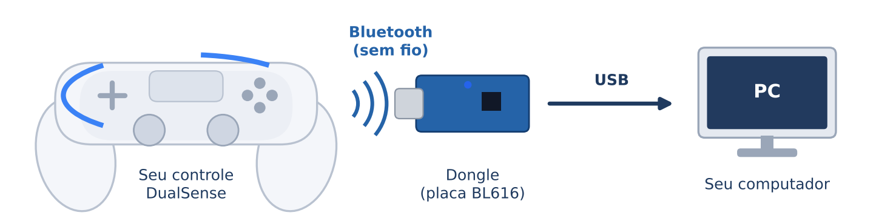
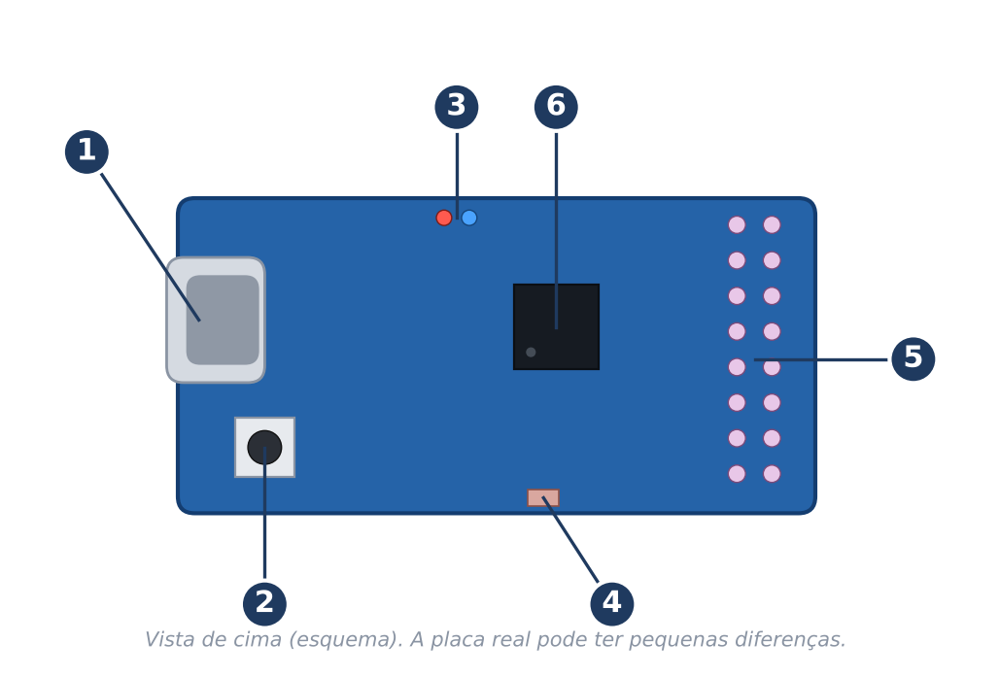
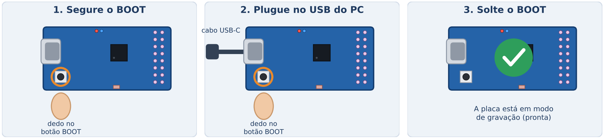
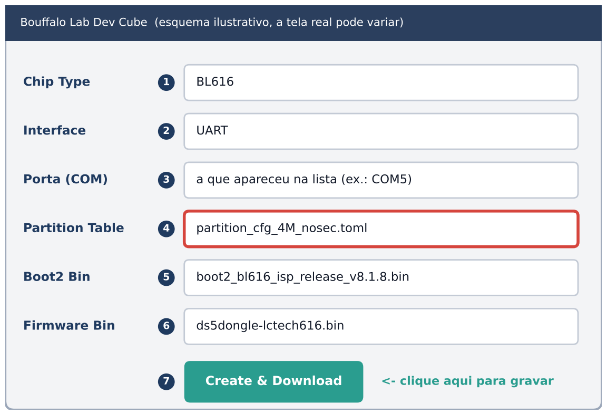
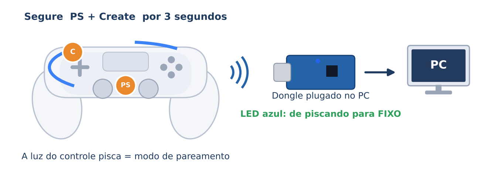
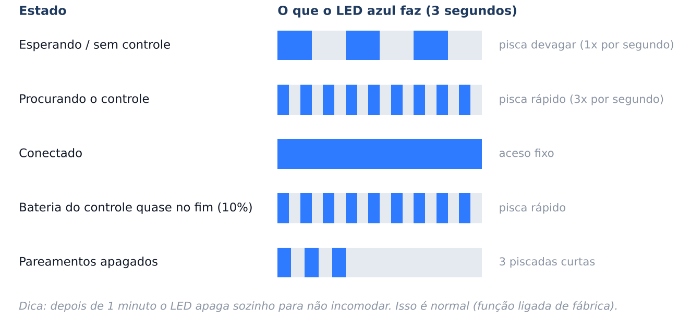
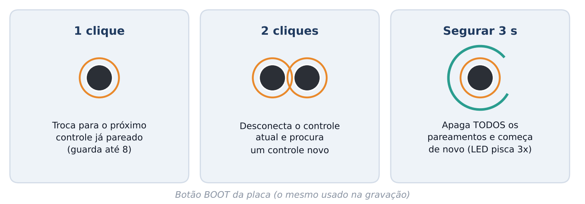
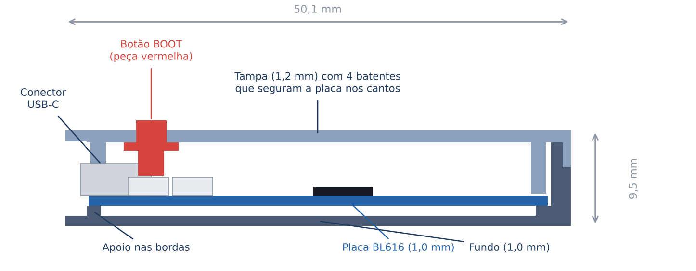

# DS5Dongle BL618

[English](README.md) | **Português**

Um adaptador sem fio para controle DualSense baseado em BL616/BL618. Ele liga um controle DualSense ou DualSense Edge por Bluetooth Classic (BR/EDR) HID a um PC host via USB HID, aparecendo como um DualSense com fio padrão (VID 054C / PID 0CE6) ou DualSense Edge (PID 0DF2). Totalmente compatível com Steam, SDL, PS Remote Play e outros.

Portado de [awalol/DS5Dongle](https://github.com/awalol/DS5Dongle) (Raspberry Pi Pico 2W). A pilha Bluetooth migrou de BTstack para o Bouffalo SDK (baseado em Zephyr) e a pilha USB, de TinyUSB para CherryUSB.

> **Projeto não oficial** — sem vínculo com a Sony Interactive Entertainment nem endosso dela. "DualSense", "DualSense Edge" e "PlayStation" são marcas registradas da Sony Interactive Entertainment. Os valores USB VID/PID (054C:0CE6 / 0DF2) são emulados para que o host enxergue um controle com fio padrão; use por sua conta e risco.

## Guia rápido para Windows (firmware pronto, sem programar)

Passo a passo para a placa **LCTech BL616**. Não precisa soldar nem saber programar; leva cerca de 10 minutos. (Versão em inglês: [README.md](README.md) · PDF: [docs/guia-pt.pdf](docs/guia-pt.pdf).)



**Você vai precisar de:** a placa BL616 (azul, com entrada USB-C e um botão escrito BOOT), um cabo USB-C de **dados** (cabo só de carga não funciona), um PC com Windows e internet, e um controle DualSense (PS5) ou DualSense Edge.

### Conheça a placa



| Nº | Peça | Para que serve |
|----|------|----------------|
| 1 | Entrada USB-C | Aqui entra o cabo que vai ao PC. Use um cabo curto de dados. |
| 2 | Botão BOOT | Usado para gravar o firmware e, depois, para trocar ou apagar pareamentos de controles. |
| 3 | LEDs | Vermelho = energia. Azul = status do dongle (veja a tabela de LED abaixo). |
| 4 | Antena de cerâmica | É o Bluetooth. Não cubra com metal nem papel alumínio. |
| 5 | Furos para pinos | **Não são usados.** O conector de 8 pinos que vem junto pode ficar guardado. |
| 6 | Chip BL616 | O cérebro: cuida do Bluetooth e do USB. |

### Passo 1 — Baixar os arquivos

1. Baixe o pacote do firmware (ZIP, cerca de 1 MB): [ds5dongle-bl618-lctech616-v3.22.zip](https://github.com/sqlCRT/ds5dongle-bl618-opensource/releases/download/v3.22/ds5dongle-bl618-lctech616-v3.22.zip).
2. Clique com o botão direito no ZIP e escolha **Extrair tudo...** (pasta sugerida: `C:\DS5Dongle`).
3. Baixe e instale o [Bouffalo Lab Dev Cube](https://dev.bouffalolab.com/download), programa oficial do fabricante do chip, usado para gravar.

*Prefere o PowerShell?* Na raiz deste repositório, rode o comando abaixo. Ele baixa o ZIP, extrai em `C:\DS5Dongle`, confere a integridade (SHA256) e abre a pasta:

```powershell
powershell -ExecutionPolicy Bypass -File docs\baixar-firmware.ps1
```

| Arquivo (na pasta extraída) | O que é |
|-----------------------------|---------|
| `ds5dongle-lctech616.bin` | Firmware **FS** (Full-Speed): **use este para começar**. Melhor compatibilidade com cabos e portas. |
| `ds5dongle-lctech616-hs.bin` | Firmware **HS** (High-Speed): leitura mais rápida, mas exige cabo e porta bons. Opcional. |
| `boot2_bl616_isp_release_v8.1.8.bin` | Programa de inicialização da placa (obrigatório na gravação). |
| `partition_cfg_4M_nosec.toml` | Tabela de partições: **sempre a versão "nosec"**. |

### Passo 2 — Colocar a placa em modo de gravação



1. Com a placa **desconectada** do PC, **aperte e segure** o botão BOOT (se for difícil, use a ponta de um clipe ou palito).
2. Sem soltar, ligue o cabo USB-C no PC.
3. Só agora solte o botão. Pronto.

**Como saber que deu certo?** No Dev Cube (próximo passo) vai aparecer uma **porta COM** nova na lista (por exemplo COM5). Se não aparecer: tente outro cabo (cabo só de carga não serve), outra porta USB, ou desligue e repita desde o início.

### Passo 3 — Configurar o Dev Cube

Abra o Dev Cube, escolha o chip e preencha como no esquema abaixo (os arquivos estão na pasta que você extraiu no Passo 1):



> **Atenção ao item 4:** escolha `partition_cfg_4M_nosec.toml`. Existe outro arquivo parecido, sem "nosec" no nome: **não use**.

### Passo 4 — Gravar o firmware

1. Confira se os 6 campos estão preenchidos e clique em **Create & Download**.
2. Espere a barra de progresso chegar ao fim e aparecer a mensagem de sucesso. **Não desligue o cabo durante a gravação.**
3. Desconecte o cabo e conecte de novo, **sem apertar o BOOT**.
4. O LED azul deve ficar **piscando devagar**: o dongle está pronto e esperando um controle.

### Passo 5 — Parear o controle



1. Com o dongle plugado no PC (LED piscando devagar) e o controle **desligado**, segure **PS + Create** por 3 segundos, até a luz do controle começar a piscar.
2. Em poucos segundos o LED do dongle pisca rápido (procurando) e depois fica **aceso fixo**: conectado.
3. O Windows passa a enxergar um **"DualSense Wireless Controller"**, como se estivesse com cabo. Abra um jogo ou o Steam e teste.

> **Dicas:** não pareie o controle pelo Bluetooth do Windows (o dongle faz isso sozinho). Se o controle estava conectado a outro aparelho (PS5, celular), desligue o Bluetooth dele antes. Nas próximas vezes basta ligar o controle com o botão PS: ele reconecta sozinho.

#### O que o LED azul da placa está dizendo



### Usando no dia a dia



- **Create + Options por 3 segundos:** alterna entre o modo DualSense e o modo **Xbox 360** (compatível com jogos XInput). O controle vibra e o dongle reinicia sozinho.
- **Botão PS:** pode acordar o PC do repouso (função ligada de fábrica). Depois de acordar, aperte PS de novo para reconectar.
- **Página de configuração (opcional):** com o dongle plugado, abra [ps5.ds5678.top](https://ps5.ds5678.top) no **Chrome ou Edge** e permita o acesso ao dispositivo. Dá para mudar a taxa de leitura, a força da háptica, remapear botões, escolher a cor da luz do controle, ligar o modo Xbox, ajustar a economia de energia e mais. A atualização online (OTA) não funciona nesta versão aberta: para atualizar, grave de novo pelo Dev Cube.

### Se algo não funcionar

| Sintoma | O que fazer |
|---------|-------------|
| O Dev Cube não mostra nenhuma porta COM | Cabo só de carga ou porta ruim. Troque o cabo/porta e refaça o Passo 2 (BOOT apertado **antes** de ligar o cabo). |
| Gravou, mas o LED azul não acende | Desplugue e plugue de novo. Se persistir, refaça a gravação conferindo se usou a partição **nosec**. |
| O controle não conecta | Controle desligado? Segure PS + Create até piscar. Se já tinha conectado antes, segure o BOOT do dongle por 3 s (apaga pareamentos) e pareie de novo. |
| Depois de um tempo parado, não reconecta | Na página de configuração, desligue a "economia de energia por inatividade". |
| Som cortando, travadinhas ou desconexões | Use uma porta USB traseira (direto na placa-mãe) e um cabo bom e curto. Prefira o firmware FS (normal) ao HS. |
| O LED apagou sozinho | Normal: ele apaga após 1 minuto. O controle continua funcionando. |

> **Importante:** depois de gravar a v3.18 ou mais nova, **não dá para voltar** a uma versão anterior à 3.18 (a placa deixa de ligar; só recupera regravando uma versão nova pela porta serial).

### Case impressa em 3D (opcional)

Case de duas peças com encaixe por pressão (sem parafusos) para a placa BL616: tamanho externo **50,1 × 27,1 × 9,5 mm**, sem pinheader, com abertura de USB-C para plugs comuns, janela para os LEDs e um pino para o botão BOOT.



- Arquivos: [`case-3d/saida/`](case-3d/saida) — `ds5dongle_case_base.step`, `ds5dongle_case_tampa.step`, `ds5dongle_case_botao.step`; o `_montada.step` serve só para visualizar.
- Para regerar ou mudar as medidas: edite `case-3d/case.py` (CadQuery) ou apenas rode `py case-3d\gerar_tudo.py`.
- **As medidas foram estimadas pelas fotos do anúncio** (placa ≈ 45,5 × 22,5 mm). Meça sua placa com um paquímetro e **imprima primeiro só a base** para testar o encaixe.
- PLA ou PETG, bico 0,4 mm, camada 0,2 mm, sem suportes. Base: fundo para baixo. Tampa: de cabeça para baixo. Botão: ponta fina (topo) para baixo.
- Montagem: placa na base (USB-C no lado da abertura grande) → botão vermelho por baixo da tampa, com a ponta passando pelo furo → feche a tampa apertando. Para abrir, use o entalhe na ponta oposta ao USB.

---

## Placas suportadas

| Placa | Chip | USB | LED | Debug |
|-------|------|-----|-----|-------|
| **LCTech BL616** (padrão) | BL616 QFN32 | Type-C nativo | 1x azul (GPIO27) | USB-TTL externo |
| **Ai-M61-32S-Kit** | BL618 QFN56 | Fios soltos em GPIO37/38 | RGB + branco (4 LEDs) | Type-C CH340 |
| **Sipeed M0S Dock** | BL616 QFN32 | Type-C nativo | 2x vermelho (GPIO27/28) | USB-TTL externo |

> **O alvo de compilação padrão é a LCTech BL616.** O `build_macos.sh` (e o wrapper `build_lctech616.sh`) compila para ela direto; use `BOARD_TYPE=aim61` ou `BOARD_TYPE=m0sdock` para as outras placas.

Os pinos dos LEDs e a topologia USB variam por placa e são tratados em tempo de compilação via `board_config.h`.

## Requisitos de hardware

- Placa **LCTech BL616**, **Ai-M61-32S-Kit** ou **Sipeed M0S Dock**
- **Controle DualSense** (0CE6 padrão) ou **DualSense Edge** (0DF2, detectado automaticamente)
- LCTech BL616 / M0S Dock: só um cabo USB-C (USB nativo)
- Ai-M61-32S-Kit: **cabo USB de dados** (cortado e ligado aos pinos USB_DM/USB_DP)
- Para debug serial da LCTech / M0S Dock: **adaptador USB-TTL** (CH340/CH341, 3,3 V)

### Ligação USB (somente Ai-M61-32S-Kit)

A porta Type-C da placa é uma ponte UART (para gravação/debug). O USB nativo precisa ser ligado pelos pinos do conector:

```
Pino 37 (USB_DM) → USB D- (branco)
Pino 38 (USB_DP) → USB D+ (verde)
GND              → USB GND (preto)
```

Se o host não fornecer energia pelo USB, a placa precisa de alimentação separada pela porta Type-C.

> **LCTech BL616 / M0S Dock**: o USB é nativo via Type-C. Não precisa ligar nada.

## Compilando do código-fonte (desenvolvedores)

### 1. Bouffalo SDK (fork do DS5Dongle — obrigatório)

> O Bouffalo SDK oficial **não** funciona com este projeto — faltam os pools net_buf de BT HID e o tratamento de requisições de USB Audio. É preciso usar o fork do SDK do projeto:

```bash
git clone https://github.com/sqlCRT/bouffalo_sdk.git bouffalo_sdk
```

O script de build espera o SDK em `../bouffalo_sdk` (pasta irmã deste repositório) e compila contra a branch `master` do fork. O fork é baseado no upstream v2.3.28 com modificações específicas do DS5Dongle BL618; veja o README dele.

### 2. Dependências

```bash
# macOS
brew install cmake
brew install make          # GNU Make 4.0+ exigido pelo SDK

# Linux (Ubuntu)
sudo apt install cmake make
```

### 3. Toolchain RISC-V

O BL616/BL618 usa o conjunto de instruções estendido T-Head. Um `riscv64-elf-gcc` comum não funciona.

```bash
# macOS ARM64 — toolchain T-Head pré-compilada da comunidade
curl -L https://github.com/beckmx/bouffalo_labs_mac_toolchain/releases/download/v1.0/riscv64-unknown-elf-toolchain.tar.gz \
  | tar xz -C ~/riscv-toolchain

# Linux — o SDK traz a própria toolchain, ou baixe da T-Head
```

O `build_macos.sh` detecta automaticamente a toolchain em `~/riscv-toolchain/toolchain/bin`.

### 4. Compilar

```bash
cd ds5dongle-bl618

# LCTech BL616 — padrão
bash build_macos.sh build      # compilação incremental (-j automático)
bash build_macos.sh rebuild    # limpa + compila
# ou: bash build_lctech616.sh rebuild

# Ai-M61-32S-Kit
BOARD_TYPE=aim61 bash build_macos.sh rebuild

# Sipeed M0S Dock
BOARD_TYPE=m0sdock bash build_macos.sh rebuild
# ou: bash build_m0sdock.sh rebuild

# Velocidade USB — Full-Speed é o padrão (melhor compatibilidade com cabos);
# use USB_SPEED=hs para a variante High-Speed de 480 Mbps
USB_SPEED=hs bash build_macos.sh rebuild

# Outros comandos
bash build_macos.sh clean      # só limpa
bash build_macos.sh strip      # remove .o/.a para reduzir a pasta de build
```

- **Placa padrão: LCTech BL616** (`BOARD_TYPE=lctech616`).
- **Velocidade USB padrão: Full-Speed (12 Mbps)**; passe `USB_SPEED=hs` para compilar a variante High-Speed (taxa de leitura maior, mais sensível à qualidade do cabo).
- Trocar `BOARD_TYPE` ou `USB_SPEED` dispara uma recompilação limpa automática (cache do CMake incompatível).

Saída: `firmware/{placa}/ds5dongle-{placa}.bin` (~800 KB), mais os arquivos boot2/partição e um `flash_prog_cfg.ini`. Os binários compilados são ignorados pelo git — anexe-os a uma Release do GitHub se quiser distribuir firmware pronto.

#### Windows

No Windows, clone a toolchain T-Head e use o script fornecido:

```bat
git clone https://gitee.com/bouffalolab/toolchain_gcc_t-head_windows.git

build_windows.bat both         rem compila as variantes Full-Speed + High-Speed
build_windows.bat rebuild      rem LCTech BL616, Full-Speed
build_windows.bat              rem compilação incremental
build_windows.bat flash COM5   rem grava pela serial
```

`build_windows.bat both` gera `ds5dongle-lctech616.bin` (Full-Speed) e `ds5dongle-lctech616-hs.bin` (High-Speed); também é possível compilar só a High-Speed com `USB_SPEED=hs build_windows.bat rebuild`.

O script espera o fork do SDK DS5Dongle BL618 em `..\bouffalo_sdk` (passo 1) e a toolchain em `%USERPROFILE%\Desktop\toolchain_gcc_t-head_windows` por padrão. Altere com as variáveis de ambiente `BL_SDK_BASE` / `TOOLCHAIN_PATH`; outras placas com `BOARD_TYPE=aim61` / `BOARD_TYPE=m0sdock`.

### 5. Gravar

#### LCTech BL616 — Dev Cube (modo UART/ISP)

1. Compile o firmware antes — o script de build gera `ds5dongle-lctech616.bin`, `boot2_bl616_isp_release_v8.1.8.bin` e `partition_cfg_4M_nosec.toml` em `firmware/lctech616/`.
2. Segure o botão **BOOT** da LCTech BL616, depois ligue a placa no PC pelo USB-C, mantendo o BOOT apertado até a placa entrar no modo de download UART (ISP).
3. Abra o [Bouffalo Lab Dev Cube](https://dev.bouffalolab.com/download), escolha o chip **BL616** e o modo de gravação **ISP (UART)**.
4. Selecione a porta COM da placa e carregue estes arquivos:
   - Tabela de partição: `firmware/lctech616/partition_cfg_4M_nosec.toml`
   - Boot2: `firmware/lctech616/boot2_bl616_isp_release_v8.1.8.bin`
   - Firmware: `firmware/lctech616/ds5dongle-lctech616.bin`
5. Inicie o download.

> Use a tabela de partição `_nosec` (`partition_cfg_4M_nosec.toml`), não a `partition_cfg_4M.toml`.

Alternativamente, grave pelo script de build:

```bash
bash build_macos.sh flash /dev/tty.usbserial-xxx
```

As outras placas seguem o mesmo fluxo do Dev Cube; use os arquivos gerados em `firmware/{placa}/`.

## Uso

1. Ligue a porta Type-C da LCTech BL616 ao host (energia + dados USB). Para debug serial, conecte também um adaptador USB-TTL (CH340/CH341, 3,3 V)
2. Coloque o controle em modo de pareamento (segure **PS + Create** por 3 segundos; a barra de luz pisca)
3. Observe o LED azul da placa para ver o status (tabela de LED abaixo)
4. O host deve enxergar "DualSense Wireless Controller"

> **Nota sobre a Ai-M61-32S-Kit:** a porta Type-C dela é uma ponte UART (só gravação/debug) — o USB nativo precisa ser ligado dos pinos (USB_DM/USB_DP/GND) ao host; veja "Ligação USB" acima.

### Indicadores de LED

A LCTech BL616 tem um único LED azul (GPIO27); os estados se distinguem pelo ritmo de piscadas:

| Estado | Padrão (LED azul único) |
|--------|-------------------------|
| Ocioso / aguardando pareamento | Pisca lento (~1 Hz) |
| Procurando | Pisca rápido (~3 Hz) |
| Conectado | Aceso fixo |
| Acabou de desconectar | Pisca (~1 Hz) por ~3 s, depois volta ao pisca lento |
| Bateria ≤20% (descarregando) | Pisca médio (~1,7 Hz) |
| Bateria ≤10% (descarregando) | Pisca rápido (~3 Hz) |
| Apagar sozinho | Apaga após 1 min (ligado por padrão; avisos de bateria não são afetados) |
| Confirmação de evento | Uma piscada |
| Pareamentos apagados | Três piscadas |

> **Nota Ai-M61-32S-Kit (LEDs RGB + branco):** ocioso = roxo piscando lento (1 Hz); procurando = roxo piscando rápido (~3 Hz); conectado = verde fixo; acabou de desconectar = vermelho piscando lento, passa para roxo após ~3 s; bateria ≤20% = verde-amarelo piscando médio; bateria ≤10% = vermelho piscando médio; confirmação de evento = azul, uma piscada; pareamentos apagados = azul, três piscadas.
>
> **Nota Sipeed M0S Dock (dois LEDs vermelhos, GPIO27/28):** o LED0 (perto do Type-C) pisca em ocioso/procurando, o LED1 fica fixo quando conectado; desconexão = ambos piscam juntos; aviso de bateria = LED0 pisca rápido; crítico = ambos piscam.

### Gestos do botão BOOT

| Gesto | Ação |
|-------|------|
| **Um clique** | Troca para o próximo controle pareado (guarda até 8) |
| **Dois cliques** | Desconecta o controle atual e procura um novo (chaves de pareamento preservadas) |
| **Segurar (3 s)** | Apaga todos os pareamentos e começa a procurar (três piscadas do LED confirmam) |

## Recursos

### Implementados

- BT Classic HID Host: inquiry, SDP, L2CAP, pareamento automático SSP
- Passagem completa de entrada: analógicos, botões, gatilhos, giroscópio, acelerômetro, touchpad, bateria
- Passagem completa de saída: vibração, barra de luz RGB, indicadores de jogador, gatilhos adaptativos
- Passagem de áudio (bidirecional): UAC1 4ch 48 kHz OUT → codificação Opus → relatório BT 0x39 de quadro duplo (547 B, alto-falante/headset); microfone BT em Opus → decodificação → UAC1 2ch 48 kHz IN (microfone)
- Háptica HD: USB Audio Ch2/Ch3 → decimação 16:1 → tag háptica BT 0x92
- Suporte completo ao DualSense Edge: detecção automática → handshake de desbloqueio → pré-carga de perfis → descritor de 437 B, troca automática de PID (0DF2)
- Memória de vários controles: lembra até 8 controles pareados, um clique para trocar
- Reconexão iniciada pelo controle via registro de servidor L2CAP (modelo passivo)
- Reconexão robusta: nova busca periódica (~30 s), watchdog de conexão (detecção de 3 s sem entrada), Link Supervision Timeout (5 s), reset do sistema como último recurso para limpar ACL travada
- Tempo ocioso: desconexão automática configurável de 0 a 60 min (padrão 30 min)
- Atalho PS: toque curto → Win+G, toque longo → Win+Tab
- Taxa de leitura configurável: 250 Hz / 500 Hz / tempo real (~750 Hz, acompanha a taxa de relatórios BT)
- Remapeamento de botões: qualquer botão do controle para outro (Feature Report 0xFB)
- MuteLight: controle do LED do botão de microfone (liga/desliga pelo botão mute do controle)
- Despertar remoto USB: FSM de 6 estados + Boot Keyboard + desligamento automático após 5 s em suspensão
- Modo furtivo USB: esconde o dispositivo USB até um controle conectar (configurável)
- Cor personalizada da barra de luz (padrão branco), além do LED RGB de status da placa
- Número de série USB: ID único do chip via eFuse (configurável, ligado por padrão)
- Redução de potência do motor dos gatilhos: configurável de 0 a 10 níveis
- Trava de volume: impede o host de mudar o volume do alto-falante/headset do controle
- LED apaga sozinho: LEDs fixos apagam após 1 min (ligado por padrão; avisos de bateria não são afetados)
- Alertas de bateria: ≤20% aviso piscando verde-amarelo, ≤10% crítico piscando vermelho
- Suporte a várias placas: LCTech BL616 (padrão), Ai-M61-32S-Kit, Sipeed M0S Dock — escolha em tempo de compilação
- Controle do nível de log em tempo de compilação (`LOG_LEVEL` 0–3)
- Arquitetura FreeRTOS com várias tarefas (BT / USB / Áudio / Mic)

### Limitações conhecidas

| Item | Descrição |
|------|-----------|
| Um controle ativo por vez | Só um controle conectado por vez; até 8 pareamentos são lembrados (um clique troca) |

### Compatibilidade de recursos do controle

O lado USB apresenta descritores HID compatíveis com DualSense (alternando automaticamente entre DS e Edge; layout padrão com fio mais os Feature Reports de configuração do dongle 0xF6–0xF9 / 0xFB), então os hosts tratam o dongle como um controle com fio.

| Recurso | Caminho dos dados | Suportado |
|---------|-------------------|-----------|
| Analógicos / Botões / Gatilhos | Passagem de HID Input | Sim |
| Giroscópio / Acelerômetro | Passagem de HID Input | Sim |
| Touchpad | Passagem de HID Input | Sim |
| Nível de bateria | Passagem de HID Input | Sim (+ alerta de bateria baixa no LED) |
| **Gatilhos adaptativos** | HID Output SetStateData | Sim |
| **Vibração** | HID Output SetStateData | Sim |
| Barra de luz RGB / LEDs de jogador | HID Output SetStateData | Sim |
| **Háptica HD** | USB Audio Ch2/Ch3 → BT 0x92 | Sim |
| Alto-falante do controle | USB Audio Ch0/Ch1 → Opus → BT 0x39 tag 0x93 | Sim |
| Microfone do controle | BT Input → decodificação Opus → USB Audio IN | Sim |
| Headset P2 3,5 mm (saída) | USB Audio → Opus → BT 0x39 tag 0x96 | Sim |
| LED de mute do microfone | BT Input botão mute → controle MuteLight | Sim |

## Configuração

As configurações persistem via `bt_settings` e são lidas/gravadas por USB Feature Reports 0xF6–0xF9. Podem ser alteradas por uma página web sem recompilar (veja Configuração web). Principais (valores padrão):

| Opção | Padrão |
|-------|--------|
| Modo do controle | Auto (DS5 / Edge / Auto) |
| Taxa de leitura | 250 Hz (250 / 500 / tempo real ~750 Hz) |
| Desconexão por inatividade | 30 min (0–60, 0 = desligado) |
| LED apaga sozinho | Ligado (após 1 min) |
| Cor da barra de luz | Branco |
| Número de série USB | Ligado |
| Modo furtivo USB | Desligado |
| Atalho PS | Desligado |
| Despertar remoto USB | Desligado |
| Ganho da háptica | 1,0 (1,0–2,0) |
| Redução do motor dos gatilhos | 0 (0–10) |
| Trava de volume | Desligado |
| Passagem de mic / alto-falante | Ligado |

## Estrutura do projeto

```
src/
├── main.c              Entrada + orquestração das tarefas FreeRTOS + ponte de dados
├── bt_hid_host.c/h     BT Classic HID Host (Inquiry + SDP + L2CAP + SSP)
├── ds5_protocol.c/h    Definições do protocolo DualSense + CRC32
├── usb_gamepad.c/h     Dispositivo USB composto (Gamepad + Boot Keyboard)
├── ds5_usb_audio.c/h   USB Audio Class 1 (4ch 48 kHz ISO OUT + 2ch 48 kHz ISO IN)
├── audio.c/h           Pipeline de áudio (resample sinc + Opus encode/decode + háptica + mic)
├── usb_wake.c/h        FSM de despertar remoto USB
├── state_mgr.c/h       Gerenciador de mesclagem condicional do SetStateData
├── config.c/h          Sistema de configuração (bt_settings + 0xF6-0xF9)
├── dse.c/h             Gerenciamento de perfis do DualSense Edge
├── remap.c/h           Remapeamento de botões
├── led_status.c/h      Indicador de status por LED (RGB na Ai-M61 / dois vermelhos na M0S Dock / único na LCTech)
├── board_config.h      Abstração de placa (pinos/polaridade dos LEDs, tipo de USB, nome da placa)
├── debug_log.h         Macros de nível de log em compilação (LOG_ERR/WRN/INF/DBG/ISR)
└── FreeRTOSConfig.h    Configuração do FreeRTOS
lib/
├── opus/               Codec Opus (ponto fixo, xiph/opus)
├── opus.cmake          Lista de arquivos-fonte do Opus
└── opus_config.h       Configuração de build do Opus
firmware/               Configs de gravação por placa + saída local de build (binários ignorados pelo git)
docs/                   Imagens e PDF do guia, script de download do firmware
case-3d/                Case 3D (arquivos STEP e scripts CadQuery)
```

## Arquitetura

```
┌──────────────┐          ┌──────────────┐          ┌──────────────┐
│  DualSense   │◄─ BT ──►│ BL616/BL618  │◄─ USB ──►│   PC host    │
│  Controle    │  BR/EDR  │ LCTech/M0S/ │  HID     │  Steam/SDL   │
└──────────────┘  HID     │   Ai-M61    │  Device   └──────────────┘
                          └──────────────┘
```

**Fluxos de dados:**

- **Entrada (Controle → Host):** o BT L2CAP recebe o Report 0x31 → remove cabeçalho HID/seq/CRC → payload de 63 bytes enviado como Report USB 0x01
- **Saída (Host → Controle):** o USB EP OUT recebe o Report 0x02 → mesclagem condicional no State Manager → Report BT 0x31 (78 B com CRC32) → envio L2CAP
- **Áudio OUT (Host → Controle):** USB Audio ISO OUT (4ch 48 kHz) → acúmulo de PCM em buffer duplo → resample sinc polifásico 512→480 → codificação Opus CBR (160 kbps) → decimação da háptica → relatório 0x39 de quadro duplo (547 B) → envio L2CAP
- **Áudio IN (Controle → Host):** quadro Opus do mic em BT 0x31 → fila → decodificação Opus (48 kHz mono) → mono para estéreo → ring buffer → USB Audio ISO IN (2ch 48 kHz)
- **Feature (bidirecional):** GET_REPORT a partir do cache do lado BT (perfis DSE suportam NAK gating) | SET_REPORT acrescenta CRC32 e encaminha pelo canal de controle L2CAP

## Configuração web

A ferramenta web de configuração é intencionalmente de código fechado, para proteger os interesses dos primeiros usuários. A página está disponível em [ps5.ds5678.top](https://ps5.ds5678.top). O firmware de código aberto ainda pode ser configurado por uma página web (USB Feature Reports 0xF6–0xF9 / 0xFB), mas **a atualização online (OTA) não é suportada nesta build aberta**. Se você conhece WebHID, criar a sua própria página de configuração é simples — com ajuda de IA dá para fazer bem rápido.

## Agradecimentos

- [awalol/DS5Dongle](https://github.com/awalol/DS5Dongle) — implementação original para Pico 2W, principal referência do protocolo
- [bouffalolab/bouffalo_sdk](https://github.com/bouffalolab/bouffalo_sdk) — SDK do BL618 + pilha BT Zephyr
- [CherryUSB](https://github.com/cherry-embedded/CherryUSB) — pilha USB
- [xiph/opus](https://github.com/xiph/opus) — codec de áudio Opus (modo ponto fixo)
- `hid-playstation.c` do kernel Linux — referência de offsets do protocolo DualSense
- Port para BL618 desenvolvido com [Cursor](https://www.cursor.com/) + Claude Opus 4.6

## Licença

Este projeto é licenciado sob a [GNU General Public License v3.0](LICENSE) (GPL-3.0). Quem usar ou modificar este código em um produto distribuído deve disponibilizar o código-fonte sob a mesma licença.

### Avisos de terceiros

- O código é portado/adaptado de [awalol/DS5Dongle](https://github.com/awalol/DS5Dongle), licenciado sob a Licença MIT (Copyright (c) 2026 awalol) — veja o [NOTICE](NOTICE) para o texto completo.
- [lib/opus](lib/opus) é o codec [xiph/opus](https://github.com/xiph/opus), licenciado BSD-3-Clause (veja `lib/opus/LICENSE_PLEASE_READ.txt`).
- [CherryUSB](https://github.com/cherry-embedded/CherryUSB) e [bouffalolab/bouffalo_sdk](https://github.com/bouffalolab/bouffalo_sdk) são dependências externas de build, licenciadas Apache-2.0.
- O `hid-playstation.c` do kernel Linux (GPL-2.0) foi usado apenas como referência de protocolo/offsets; nenhum código do kernel está incluído.
